# 🏙️ Smart Urban Governance Platform – CivicFix

<p align="center">
  <strong>Report • Track • Resolve – Making Cities Smarter</strong>
</p>

<p align="center">
  A Full Stack Smart City Issue Reporting Platform that enables citizens to report civic problems such as potholes, garbage accumulation, and broken streetlights with images and geolocation.
</p>

---

## 🚀 About the Project

CivicFix is a full-stack web application designed to improve communication between citizens and local authorities. It allows users to report civic issues, track complaint status, view nearby reported problems, and monitor resolution progress.

The platform helps create a smarter and more transparent urban environment through digital issue management.

## ✨ Key Features

- 📍 **Geospatial Nearby Search** – Find nearby civic issues using Haversine distance and Geohash.
- 🔍 **Advanced Search & Filtering** – Filter issues by category, status, and keywords.
- 🚨 **Duplicate Detection** – Identify duplicate reports using image and location similarity.
- 🛡️ **Rate Limiting** – Prevent excessive or repeated API requests.
- 📈 **Audit Timeline** – Track issue status changes and administrative actions.
- 🗺️ **Interactive Map** – Visualize reported civic issues using Leaflet Maps.
- 📸 **Image Upload** – Attach photos as evidence when reporting issues.
- 👤 **User Authentication** – Secure authentication using JWT.

## 🛠️ Tech Stack

| Category | Technologies |
|---|---|
| Frontend | React.js, JavaScript, HTML, CSS |
| Backend | Python, Django, Django REST Framework |
| Database | MySQL |
| Authentication | JWT |
| Maps | Leaflet Maps |
| API Testing | Postman |
| Version Control | Git, GitHub |

## 📸 Project Screenshots

### 🏠 Home Page
<p align="center">
  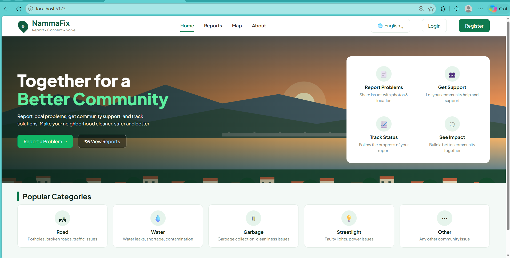
</p>

### 🔐 Authentication

<p align="center">
  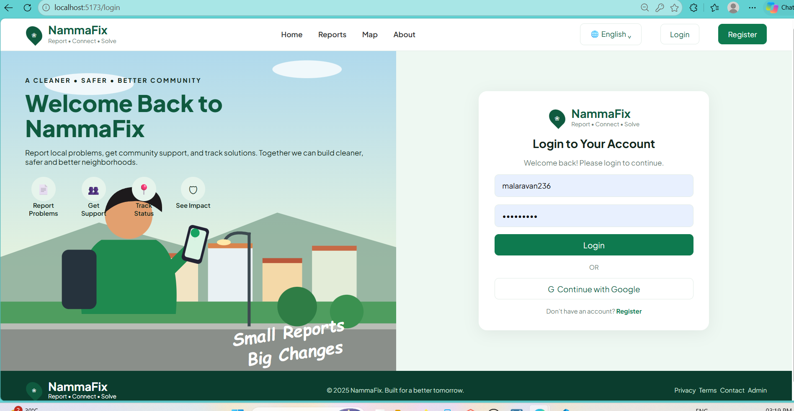
</p>

<p align="center">
  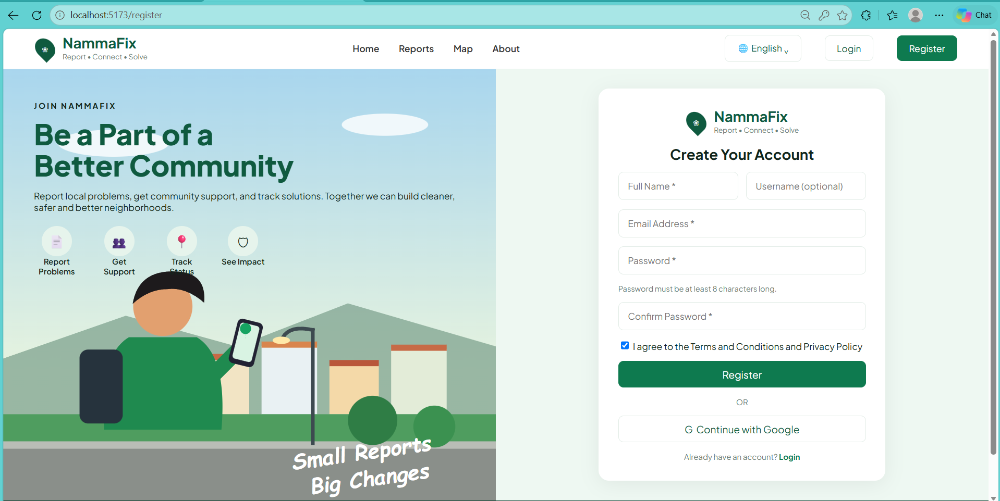
</p>

### 📊 Dashboard

<p align="center">
  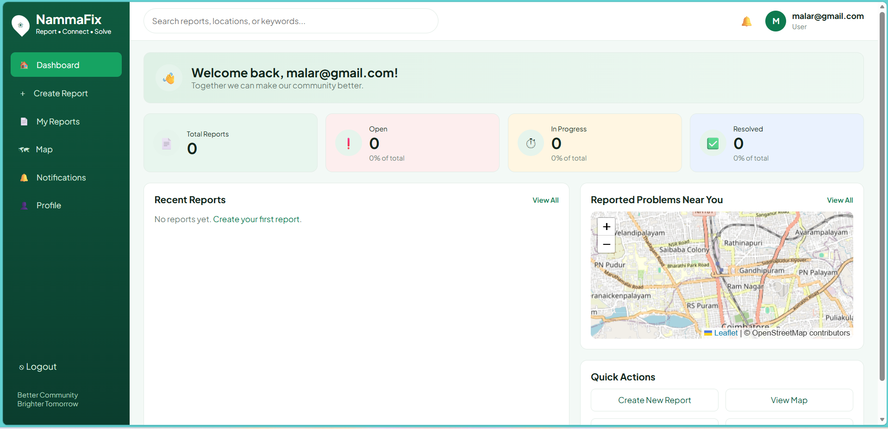
</p>

<p align="center">
  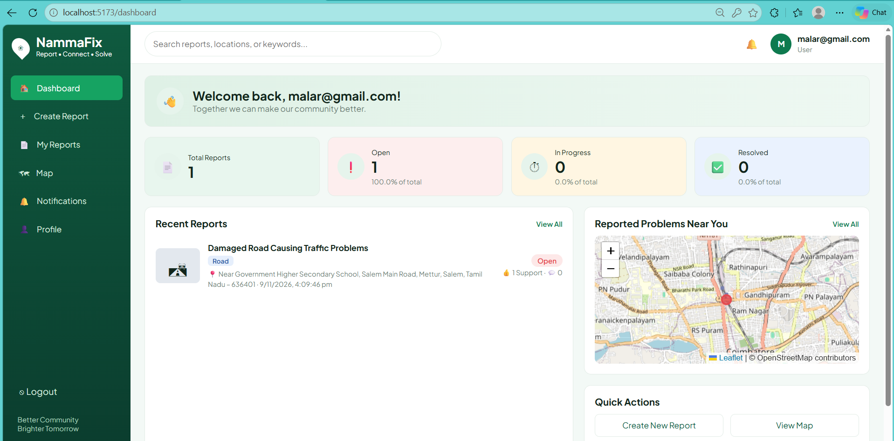
</p>

### 🗺️ Issue Map

<p align="center">
  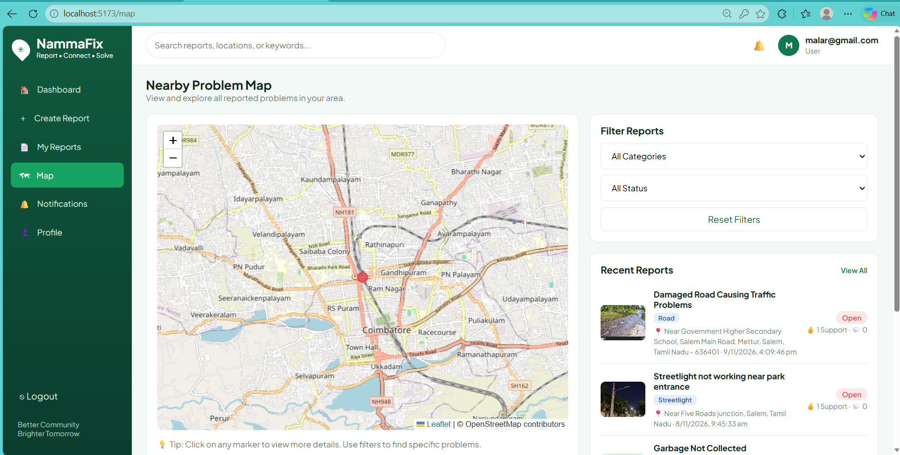
</p>

### 📝 Report Management

<p align="center">
  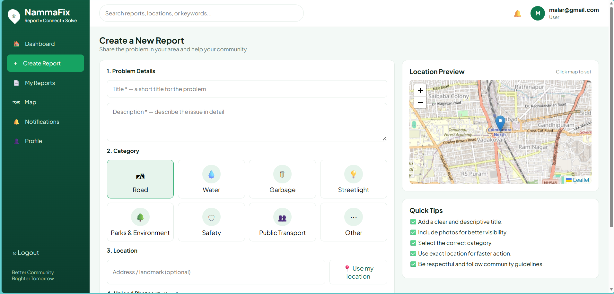
</p>

<p align="center">
  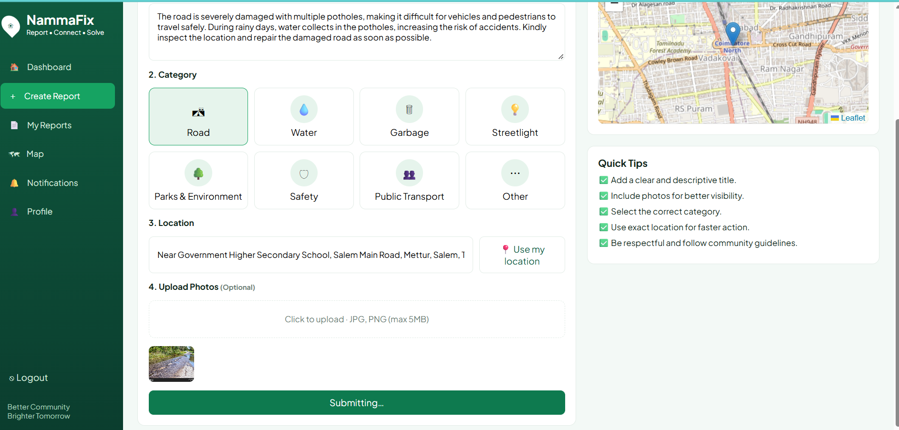
</p>

<p align="center">
  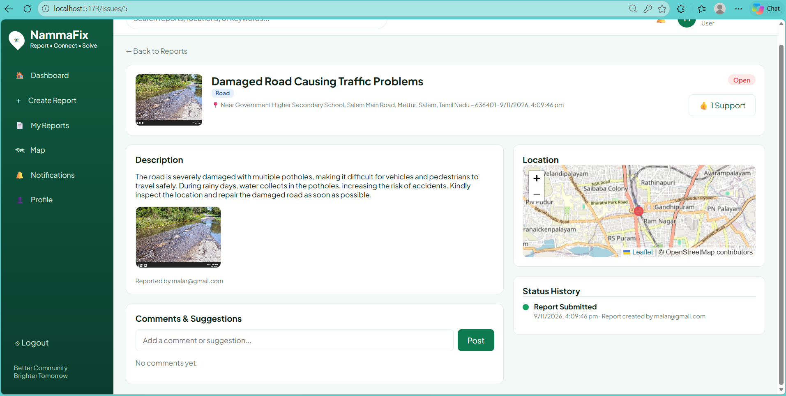
</p>

<p align="center">
  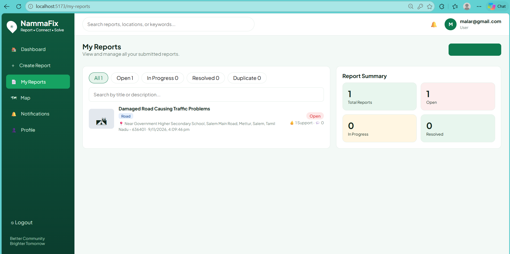
</p>

### 👤 User Profile

<p align="center">
  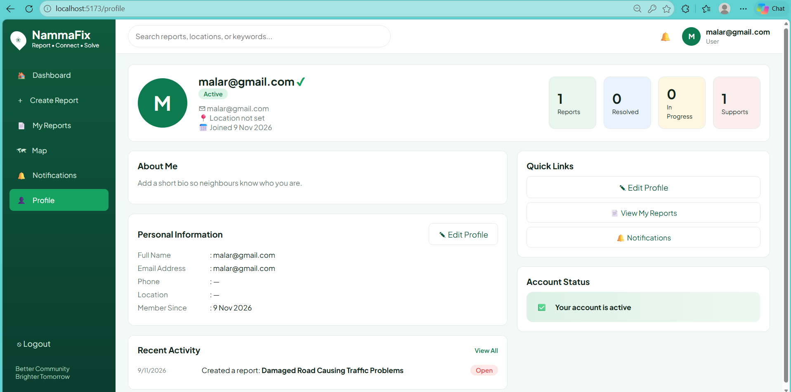
</p>

## ⚙️ Installation & Setup

### 1. Clone the Repository

```bash
git clone YOUR_GITHUB_REPOSITORY_URL
cd Smart-Urban-Governance-Platform
```

### 2. Backend Setup

```bash
cd backend

python -m venv venv
```

Activate virtual environment:

**Windows:**
```bash
venv\Scripts\activate
```

Install dependencies:

```bash
pip install -r requirements.txt
```

Run migrations:

```bash
python manage.py migrate
```

Start Django server:

```bash
python manage.py runserver
```

### 3. Frontend Setup

Open another terminal:

```bash
cd frontend
npm install
npm run dev
```

**Note:** Configure your database credentials and frontend API URL before running the application.

## 🎯 Project Objective

To provide a digital platform where citizens can report public infrastructure problems, track their complaints, and help authorities resolve civic issues efficiently.

## 👨‍💻 Developer

**Malaravan R**

Python Full Stack Developer

- GitHub: [Malaravan236](https://github.com/Malaravan236)
- LinkedIn: [Malaravan R](https://www.linkedin.com/in/malaravanr/)

---

<p align="center">
  ⭐ If you find this project useful, consider giving it a star!
</p>
